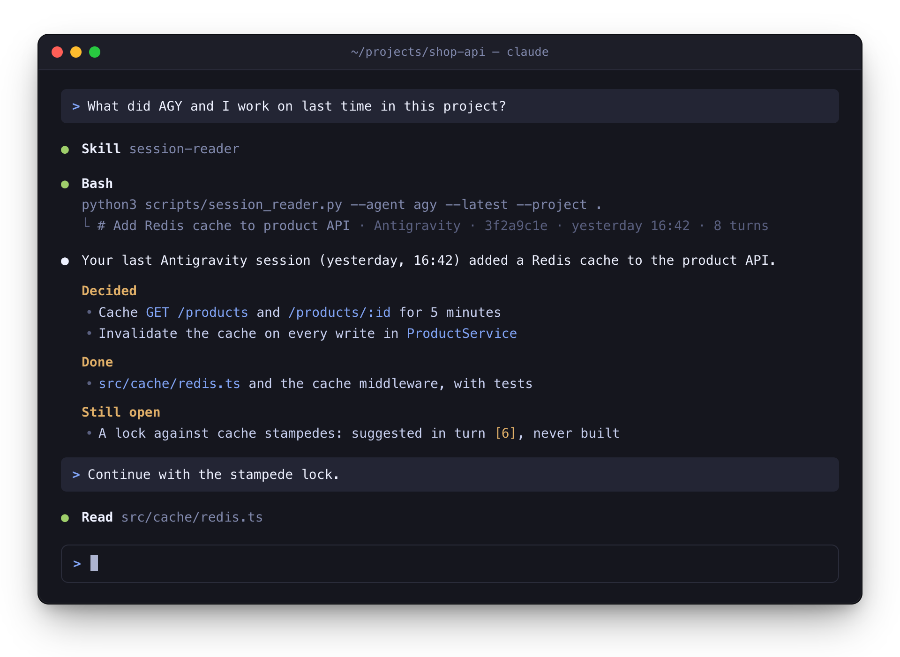

# session-reader

Let your coding agent read your past sessions with **Claude Code, Codex, OpenCode and Antigravity (agy)**.
You can pick up where another agent left off, review what was decided, or find out what actually ran.

<p align="center">
  
</p>

Other things you can ask:

```text
> What did AGY and I talk about last time?
> Why did Codex suggest SQLite in the session yesterday?
> Check whether my last Claude session missed any of my requirements.
> Which commands did Claude run in the previous session?
> Continue the work from session 3f2a9c1e.
```

session-reader is an [Agent Skill](https://agentskills.io). Once it is installed, just ask in plain language:
your agent finds the right session and reads it. It can then summarize, compare or continue the work.

## Features

- **Works across agents.** Codex can read your Claude Code sessions, Claude Code can read Antigravity
  sessions, and so on.
- **Finds the session you mean.** It can locate a session by agent, by ID or ID prefix, by date, or by the
  project you are in. Your current session is skipped, so "the last session" means the previous one.
- **Two views of a session.**
  - The **conversation** view shows just what you and the agent said.
  - The **full record** adds reasoning, tool calls, command output and errors.
- **Local and read-only.** It reads the session files your agents already keep on your machine and never
  modifies them.

## Install

Pick one method.

### Option 1: `npx skills` (works with most agents)

```bash
npx skills add haowang02/session-reader
```

You will be asked which agents to install it for. To install for all four agents at once, without prompts:

```bash
npx skills add haowang02/session-reader -g -y -a claude-code -a codex -a opencode -a antigravity
```

### Option 2: Claude Code plugin

Inside Claude Code:

```text
/plugin marketplace add haowang02/session-reader
/plugin install session-reader@session-reader
```

### Option 3: Codex skill installer

Ask Codex:

```text
$skill-installer install https://github.com/haowang02/session-reader/tree/main/skills/session-reader
```

### Option 4: Manual

```bash
git clone https://github.com/haowang02/session-reader.git ~/.local/share/session-reader
for d in ~/.claude/skills ~/.agents/skills ~/.gemini/config/skills; do
  mkdir -p "$d" && ln -sfn ~/.local/share/session-reader/skills/session-reader "$d/session-reader"
done
```

This makes the skill available to Claude Code (`~/.claude/skills`), Codex and OpenCode (`~/.agents/skills`),
and Antigravity (`~/.gemini/config/skills`).

After installing, start a new session (or reload skills) so your agent picks it up.

### Requirements

- `python3`, version 3.9 or newer, on your `PATH`. Nothing else needs to be installed.
- To read **Codex** sessions, which Codex stores compressed, you also need either Python 3.14+ or the `zstd`
  command (`brew install zstd`, `apt install zstd`). Without it, Codex sessions are still readable, but with
  less detail.

## Usage

Just ask your agent. Some examples:

| You ask | You get |
|---|---|
| "Read my latest Claude session" | Your previous Claude Code conversation |
| "What did we discuss with OpenCode in this project?" | The latest OpenCode session from the current project |
| "Summarize what I worked on with Codex yesterday" | A list of yesterday's Codex sessions, then a summary of the relevant one |
| "Compare how Claude and Codex approached the cache design" | Both sessions read and compared |
| "Why did the last AGY run fail? Include the intermediate steps" | An analysis based on the full record: reasoning, commands, errors |
| "Export session 3f2a9c1e as JSON to `session.json`" | The complete session saved to a file |
| "Continue the work from my last Antigravity session" | A recap of the goal, decisions and open items, then the work continues |

If your request doesn't pin down a single session, the agent lists the candidates and picks the best match, or
asks you.

### Running it yourself

The skill is a single script. It works without an agent, too:

```bash
S=~/.local/share/session-reader/skills/session-reader/scripts/session_reader.py   # or wherever it is installed

python3 $S --list                                  # recent sessions of all agents
python3 $S --agent claude --latest                 # previous Claude Code session as Markdown
python3 $S --id 3f2a9c1e -o transcript.md          # by session ID or ID prefix, saved to a file
python3 $S --latest --project .                    # latest session started in this directory or below
python3 $S --agent codex --latest --format json    # full record as JSON
```

Run `python3 $S --help` for all options: date filters (`--since`, `--until`), project filter, subagent
sessions, and more.

## Update and uninstall

| Installed with | Update | Uninstall |
|---|---|---|
| `npx skills` | `npx skills update` | `npx skills remove session-reader` |
| Claude Code plugin | `claude plugin update session-reader@session-reader` | `claude plugin uninstall session-reader@session-reader` |
| Codex skill installer | Delete `~/.codex/skills/session-reader` and install again | Delete `~/.codex/skills/session-reader` |
| Manual | `git -C ~/.local/share/session-reader pull` | Remove the symlinks and the clone |

## Privacy

session-reader only reads files on your machine and makes no network requests. When your agent reads a
session, though, that transcript becomes part of the agent's conversation and is processed by the agent's
model provider, just like any file you show it. Old sessions can contain secrets, such as tokens pasted into
a chat. The skill tells the agent to quote only what it needs.

## Limitations

- **Antigravity:** the skill cannot tell which Antigravity session is currently running. If you ask for "the
  latest AGY session" from inside agy, it may return the current one.
- **Reasoning:** reasoning that an agent stores encrypted, as Codex and Claude often do, cannot be shown. Only
  readable summaries appear.
- **Not supported:** the older Go-based `opencode-ai/opencode` (now Crush) and conversation files from early
  Antigravity IDE versions.

Tested against real sessions from Claude Code 2.1, Codex 0.170, OpenCode 2.3 and Antigravity CLI 1.5.
Older storage formats of Codex and OpenCode are supported as well. The test suite runs on macOS and Linux.

## Contributing

Issues and pull requests are welcome. The tests use synthetic sessions, so they never touch your real data:

```bash
python3 -m unittest discover -s tests -v
```

## License

[MIT](LICENSE)
